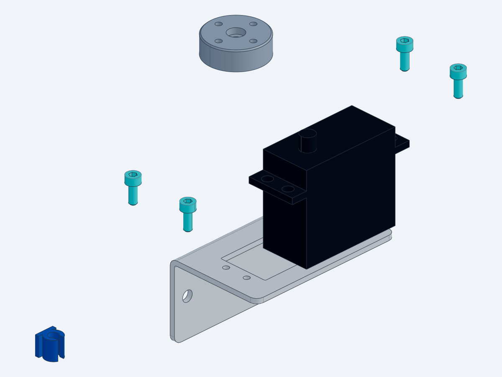

# Assembling the servo mount

Eight steps put the servo mount together (`assemblies/servo_mount.step`): tap the bracket, bond the cable clip, drop in the servo, screw it down, fit the horn adapter, clip the lead, check the horn's travel, and fix the mount to a wall. The parts are on the parts list (`docs/servo_mount_parts_list.md`).

## Before you start

- Measure your MG996R against the bracket. Its tab holes should be Ø4.1 mm, 9.5 mm apart across each tab and 47.45 mm apart along the servo, and its output axis 10.5 mm from the end of the case. None of these is in the datasheet, and the bracket's holes follow them.
- Have the parts ready: the bent bracket, the servo, the horn adapter with its spline broached, four M3 × 8 socket head screws, the printed cable clip, the adhesive and two M4 wall screws.

## 1. Tap the bracket

- Parts: the servo bracket.
- Tools: an M3 × 0.5 tap and a tap wrench.

Tap the four Ø2.5 mm holes in the shelf M3 × 0.5. Tap after bending, as the drawing's note 3 says (`drawings/servo_bracket_drawing.pdf`). Then look at the 1.725 mm web between each hole and the servo cutout: it must not bulge or crack.

## 2. Bond the cable clip to the flange

- Parts: the bracket, the cable clip, the adhesive.
- Tools: a rule or calipers to place the clip.

Bond the clip's flat face to the flange's front face, the side away from the wall, at the end where the servo's output will be. Place its outer side 1 mm in from the flange's side edge and its lower end 2 mm up from the flange's bottom edge, with the channel running up and down and its opening facing away from the flange. Do this before the servo goes in: once it is in, its case is only 5.2 mm from the clip.

## 3. Drop the servo into the cutout

- Parts: the MG996R servo.

Lower the servo into the shelf's cutout, output spline up and at the clip's end of the bracket, until its tabs sit flat on the shelf. The case has 0.3 mm a side in the cutout. Line up its four tab holes over the tapped holes.

## 4. Screw the servo down

- Parts: four ISO 4762 M3 × 8 socket head screws.
- Tools: a 2.5 mm hex key.

Put a screw through each tab hole into the tapped hole under it and tighten the four evenly, heads down on the tabs. Each tip stands 3.5 mm below the shelf, 1.8 mm clear of the servo's case. The tightening torque is not set yet: the threads have only 2 mm of aluminium to hold in.

## 5. Fit the horn adapter

- Parts: the horn adapter, the servo's own M3 horn screw.
- Tools: a screwdriver to suit the horn screw.

Push the adapter onto the servo's output spline, its broached bore down and its counterbore up, until the end of the bore sits on the top of the spline: it goes 4 mm on. Fix it with the horn screw through the Ø3.4 mm hole, its head in the Ø6.5 mm counterbore. The adapter then stands 1.7 mm clear of the servo's case.

## 6. Clip the lead

- Parts: the servo's lead.

Press the servo's lead into the clip's Ø4 mm channel through its 2.6 mm opening.

## 7. Check the horn's travel

- Tools: a servo tester or controller, and a 4.8 V supply, the lower of the two the datasheet rates the servo at.

Drive the servo through its whole travel, 60° each way from the middle. The adapter must touch nothing, and the lead must stay in its clip. In the model the adapter keeps 1.7 mm from the case at every angle.

## 8. Fix the mount to a wall

- Parts: two M4 screws, with fixings for the wall.
- Tools: to suit the screws and the wall.

Hold the flange's back flat on the wall and screw it on through its two Ø4.5 mm holes, 52 mm apart and 16 mm below the top of the shelf.

## Open questions

- What torque for the four M3 screws in 2 mm of 5052-H32, and for the horn screw?
- Which adhesive, and how to prepare the PETG and the aluminium for it?
- Is the servo's own horn screw the right length through the adapter?
- Which tooth of the spline should the adapter go on, so its four holes sit where the load needs them in the middle of the travel?
- Which screws and fixings for the wall?
